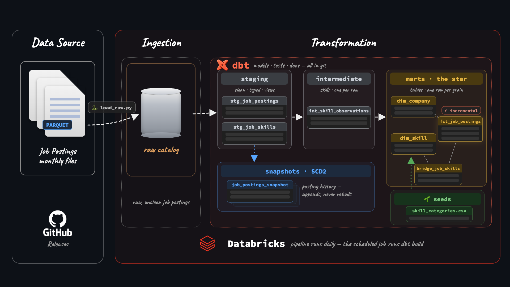

# Production Job Postings Pipeline (v2) - dbt + Databricks



A production dbt pipeline on **Databricks** over 843,097 raw job-posting scrapes, rebuilt nightly by nightly job with zero secrets.

- Shapes medallion layers into tasted star schema - 491,140 jobs at a decalred grain
- Tracks a year of salary history with SCD2 snapshots - 504,591 version controls
- Loads incrementally and runs itself on a scheduled Databricks job - no Tokens anywhere

> **v2 of this pipeline** - [`v1`](https://github.com/KelvinAttoh/dbt-Data-Engineering-Course/tree/main/dbt-duckdb-pipeline) bulit the foundations on DuckDB + GitHub Actions. v2 moves the same dataset to a real warehouse: Databricks, SCD2 history, incremental loads and a scheduled job.

| What I Built | How I Implemented | Where To Look |
| --- | --- | --- |
| **Star Schema** | fact + dims + bridge on declared grain | [`analytics/models/marts/`](analytics/models/marts/)
| **SCD2 Snapshots** | a year of salary history, backfilled | [`analytics/snapshots`](analytics/snapshots/) + [`scripts/`](scripts/)
| **Incremental fact** | merge on `job_id`, only new days load | [`fct_job_postings.sql`](analytics/models/marts/fct_job_postings.sql)
| **Macros** | a custom parser + an overriden built-in | [`analytics/macros/`](analytics/macros/)
| **Tests** | generic, singular and custom generic | [`analytics/tests`](analytics/tests/) + properties YAMLs | 
| **Environments** | dev/prod as catalogs: dev from laptop, prod only from the job | Unity Catalog: `dev` + `prod` |
| **Orchestrations** | scheduled Databricks Job, zero secrets | Databricks → Jobs & Pipelines |
| **Analyses** | questions, keep next to the models that answer them | [`analytics/analytics`](analytics/analyses/)

## ⚙️ The dbt Pipeline

Raw scrapes flow through the medallion layers - raw → staging → intermediate → the star-schema marts while snapshots capture history off staging. The lineage graph below is every model dbt builds: 


And the dbt features doing the work:

| dbt Feature | How I Used It | 
| --- | --- |
| Declared sources | `source('jobs', 'raw_job_postings')` - no hardcoded paths |
| Jinja beyond templating | benefits flags generated by a loop; one edit adds a flag |
| Custom macro | `parse_salary()` - one expressions, written once, used four times | 
| Installed packages | `dbt_utils.get_column_values()` - the roles loop reads the data instead of a type list |
| Overriding a built-in | `generate_schema_name` - schema lands where the folder says |
| Seeds | the skill taxanomy: versioned-controlled referenced data |
| Test driven cleaning | `not_null`surfaced 6,255 real id-less postings; dropped with eyes open, documented |
| Singular + custom tests | `assert_salaries_sane` caught 27 typed `-...1M` salary ceilings the scehma tests never would |
| SCD2 snapshots | `check` strategy on 13 content columns, `searched_at` dates the versions | 
| Incremental | merged on `job_id`; `is_incremental()` + a `search_date` high-water filter |
| Environments | `dev` catalog from local profile, `prod` only from the scheduled job |

---

## 🚀 Production

**Databricks** owns the run time - storage, compute, and the schedule, one platform:

- **Dev and prod as catalogs**: laptop builds in the dev catalog; only the schedule jobs writes the same schemas into `prod`

- **Schedule Databricks Job** run the whole pipeline nightly: `load_raw` (the ingest notebook), then `dbt deps` → `dbt debug` → `dbt build`, pulling the repo staright from GitHub

- **Zero secrets**: the job generates temporary-credentials profile against the attached warehouse and revokes it after the run - no Tokens in the repo, no CI secrets


Any BI tool connect straight to the warehouse - SQL Editor, Excel, PowerBI, and Tableau all query the `prod` catalog directly.

---

## 📸 Snapshots

The marts keep each job's **latest** scrape - the snapshot table keep **every version**, SCD2 over 13 watched columns:

- **509,591** version rows across **491,140** jobs - **10,187** jobs with real changed history

- **2,756** postings changed their salary between scrapes


---

## 📖 Docs

Structure, tests, and column descriptions were written along the way - the doc site is a rendering of work already done:

** → []**

The site shows:

- The full lineage graph(raw → staging → intermediate → the star → snapshot)
- Model and column descriptions from the YAMLs
- Which column carry tests

The same descriptions live in the warehouse itself -- `persist_docs` pushed them into Unity Catalog, so Catalog Explorer shows them right next to the data.


--- 

## 💻 Run It Yourself

Prerequisites: a Databricks workspace (the [Free Edition](https://www.databricks.com/learn/free-edition) works) with the raw job-postings loaded into a `raw` catalog. Then:

```bash 
uv sync && source .venv/bin/activate
# env
dbt deps
# macro packages (dbt_utils) - dbt_packages/ isn't committed
dbt debug
# connections (profiles.yml holds your host/token)
dbt build 
# models + test + seed
dbt snapshot
# one SCD2 pass (nightly in production)

